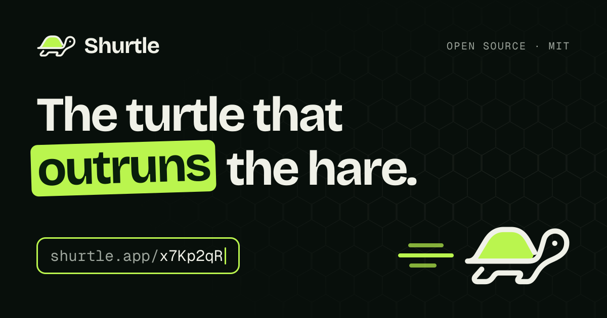

<div align="center">



# Shurtle

**An open source URL shortener that redirects before a single page renders.**

[](https://github.com/danihengeveld/shurtle-ts/actions/workflows/ci.yml)
[](https://github.com/danihengeveld/shurtle-ts/releases/latest)
[](LICENSE)

[**shurtle.app**](https://shurtle.app) · [Releases](https://github.com/danihengeveld/shurtle-ts/releases) · [Report a bug](https://github.com/danihengeveld/shurtle-ts/issues/new)

</div>

---

Shurtle turns long URLs into short, readable links (`shurtle.app/x7Kp2qR`) and shows you who clicks them. It's built on Next.js 16 with the App Router, and resolves short links in the proxy layer, so a redirect never waits on rendering.

## Features

- **Short links, your way.** Paste a URL and get a short link, or pick your own slug. URLs without `https://` are fixed up, and equivalent URLs are recognised as the same link.
- **Click stats.** Per-link clicks and last-click time, totals with a week-over-week trend, and a 30-day clicks chart.
- **A page for every link.** Clicks over time with the change from the previous period, a world map with top countries and cities, the busiest weekday and hour, the sites that send people, and their devices, browsers and systems, from the last 24 hours to all time. Bots and link previews don't count. [See the demo](https://shurtle.app/demo).
- **Links with a shelf life.** Expire a link at a chosen date and time, and change it whenever you like. Expired links stop redirecting but keep their stats.
- **A second chance.** For 24 hours after a link expires, its slug stays reserved for you: renew it and it's back with every click. After that, anyone can claim the slug, and the expired page counts down to that moment.
- **Claim a free slug.** Visiting an unused short link offers to create it on the spot.
- **A dashboard that keeps up.** Server-side search, pagination, one-click copy, keyboard shortcuts (<kbd>N</kbd> new link, <kbd>/</kbd> search), and lists that update themselves when a link expires.
- **Abuse protection.** Rate limits on opening links (per IP) and creating them (per user), plus a friendly "slow down" page.
- **Polished and accessible.** Light and dark themes, a phone-friendly layout with bottom-sheet dialogs, and keyboard and screen-reader support throughout.

## How it works

```
GET shurtle.app/x7Kp2qR
  └─ proxy.ts ─ rate limit (Upstash) ─ look up slug (Postgres)
       ├─ live      → 307 redirect, click recorded in the background
       ├─ expired   → 410 page with a countdown to the slug's release
       └─ unknown   → 404 page that offers to claim the slug
```

- **Redirects happen in the proxy.** [`src/proxy.ts`](src/proxy.ts) recognises single-segment paths, rate-limits by IP, resolves the slug and redirects before any page renders. The click is recorded with `waitUntil`, so it never slows the redirect down.
- **Clicks are recorded with care.** Each visit stores its time and place, the referring site's host, and the device type, browser and OS ([`src/lib/visit.ts`](src/lib/visit.ts)). It never stores an IP address, the raw user agent or the full referring URL. Bots and link previews are stored with a flag and left out of every count.
- **Links have a lifecycle.** [`src/lib/link-lifecycle.ts`](src/lib/link-lifecycle.ts) defines it, from live to renewable to released:
  - **Live:** the link redirects.
  - **Renewable:** expired, with the slug reserved for its owner for 24 hours.
  - **Released:** the slug is free for anyone.

  Each link has its own id, and a slug is unique only among unreleased links (a partial unique index). A released slug can therefore be reused while the old link keeps its history. Release is decided by the clock; a daily cron only tidies up afterwards.

- **The dashboard streams.** With Cache Components the page shell is prerendered, and the stats, chart and links stream in behind Suspense boundaries. Per-user data is cached with `"use cache"`, invalidated the moment you change a link, and expires on its own at the user's next expiry. A failing section shows its own "Try again" instead of taking the page down.
- **Auth lives in the data layer.** Every read and write resolves the signed-in user itself ([`src/server/queries.ts`](src/server/queries.ts), [`src/server/mutations.ts`](src/server/mutations.ts)), rather than relying on route matching. Server Actions stay thin: validate, rate-limit, delegate, invalidate.

## Tech stack

| Area          | Technology                                                                                                                                                                                                                                    |
| ------------- | --------------------------------------------------------------------------------------------------------------------------------------------------------------------------------------------------------------------------------------------- |
| Framework     | [Next.js 16](https://nextjs.org/) (App Router, Cache Components, React Compiler, Turbopack)                                                                                                                                                   |
| UI            | [React 19](https://react.dev/), [Tailwind CSS 4](https://tailwindcss.com/), [shadcn/ui](https://ui.shadcn.com/) on [Radix](https://www.radix-ui.com/), [Recharts](https://recharts.org/), [d3-geo](https://d3js.org/d3-geo) for the world map |
| Database      | [Neon Postgres](https://neon.tech/) with [Drizzle ORM](https://orm.drizzle.team/)                                                                                                                                                             |
| Auth          | [Clerk](https://clerk.com/)                                                                                                                                                                                                                   |
| Rate limiting | [Upstash Redis](https://upstash.com/) with `@upstash/ratelimit`                                                                                                                                                                               |
| Validation    | [Zod 4](https://zod.dev/)                                                                                                                                                                                                                     |
| Logging       | [pino](https://getpino.io/), with no IP addresses, emails or full URLs in logs                                                                                                                                                                |
| Hosting       | [Vercel](https://vercel.com/) (Cron, Analytics, Speed Insights)                                                                                                                                                                               |
| Tooling       | TypeScript, ESLint, Prettier, [Vitest](https://vitest.dev/), GitHub Actions, CodeQL, Dependabot                                                                                                                                               |

## Getting started

### Prerequisites

- Node.js 26 LTS or newer
- pnpm: `corepack enable` picks up the version pinned in `package.json`
- A Postgres database ([Neon](https://neon.tech/), or Vercel's Neon integration)
- An [Upstash](https://upstash.com/) Redis database
- A [Clerk](https://clerk.com/) application

A [devcontainer](.devcontainer/devcontainer.json) with Node 26, pnpm and the recommended editor extensions is included if you prefer to work in a container.

### Setup

```bash
git clone https://github.com/danihengeveld/shurtle-ts.git
cd shurtle-ts
pnpm install
```

Create `.env.local` in the project root:

```env
POSTGRES_URL="postgres://..."
KV_REST_API_URL="https://...upstash.io"
KV_REST_API_TOKEN="..."
NEXT_PUBLIC_CLERK_PUBLISHABLE_KEY="pk_..."
CLERK_SECRET_KEY="sk_..."
CRON_SECRET="any-long-random-string"
```

Then create the schema and start the dev server:

```bash
pnpm db:push
pnpm dev
```

Open [http://localhost:3000](http://localhost:3000).

### Environment variables

| Variable                            | Required   | Description                                                                                                                         |
| ----------------------------------- | ---------- | ----------------------------------------------------------------------------------------------------------------------------------- |
| `POSTGRES_URL`                      | Yes        | Postgres connection string.                                                                                                         |
| `KV_REST_API_URL`                   | Yes        | Upstash Redis REST URL, for rate limiting.                                                                                          |
| `KV_REST_API_TOKEN`                 | Yes        | Upstash Redis REST token.                                                                                                           |
| `NEXT_PUBLIC_CLERK_PUBLISHABLE_KEY` | Yes        | Clerk publishable key.                                                                                                              |
| `CLERK_SECRET_KEY`                  | Yes        | Clerk secret key.                                                                                                                   |
| `CRON_SECRET`                       | Production | Bearer token for the daily cron endpoint. The endpoint refuses to run without it.                                                   |
| `NEXT_PUBLIC_SITE_URL`              | No         | Public origin for short links and metadata. Defaults to `http://localhost:3000` in development and `https://shurtle.app` otherwise. |
| `LOG_LEVEL`                         | No         | `trace`, `debug`, `info`, `warn` or `error`. Defaults to `debug` in development and `info` in production.                           |
| `DEBUG_SQL`                         | No         | Set to `1` to log every SQL query in development.                                                                                   |

### Scripts

| Command                        | Description                              |
| ------------------------------ | ---------------------------------------- |
| `pnpm dev`                     | Start the dev server (Turbopack)         |
| `pnpm build` / `pnpm start`    | Build for production / serve the build   |
| `pnpm lint`                    | ESLint                                   |
| `pnpm typecheck`               | Generate route types and type-check      |
| `pnpm test`                    | Run the unit tests (Vitest)              |
| `pnpm format` / `format:check` | Format with Prettier / check formatting  |
| `pnpm db:push`                 | Apply the Drizzle schema to the database |
| `pnpm db:studio`               | Open Drizzle Studio                      |

## Project structure

```
src/
├─ app/
│  ├─ (marketing)/        landing page
│  ├─ (short-link)/       pages the proxy rewrites short links to: expired/, slow-down/
│  ├─ dashboard/          layout (header, stats, toolbar), (active)/ and expired/ lists
│  ├─ api/cron/           daily job that releases expired slugs
│  └─ …                   metadata routes (icons, manifest, OG image, robots, sitemap)
├─ components/            shared UI: ui/ (shadcn), layout/, logo, theme
├─ lib/                   client-safe logic: slugs, link lifecycle, schemas, list queries
├─ server/                server-only: db/, auth, queries, mutations, actions, rate limits
└─ proxy.ts               short-link resolution, then Clerk for everything else
```

Folders starting with `_` are private (never routes) and folders in `(parentheses)` are route groups (not part of the URL).

## Deploying

Shurtle is built for [Vercel](https://vercel.com/): import the repository, add the environment variables above and deploy. [`vercel.json`](vercel.json) schedules `/api/cron/archive-expired` daily; Vercel sends `CRON_SECRET` as a bearer token automatically.

It also runs anywhere Next.js does (`pnpm build && pnpm start`). Analytics and Speed Insights only load on Vercel, and you'll need to call the cron endpoint yourself, for example once a day:

```bash
curl -H "Authorization: Bearer $CRON_SECRET" https://your-domain.example/api/cron/archive-expired
```

### Upgrading

New installs only need `pnpm db:push`. When upgrading an existing database, check the [release notes](https://github.com/danihengeveld/shurtle-ts/releases) for steps. Manual migrations live in [`drizzle/manual/`](drizzle/manual/) and must run before the new version is deployed. For example, upgrading from a version before 2.2 requires `0001_link_ids_and_slug_reuse.sql`. Upgrading to 3.0 only adds columns for click details: run `pnpm db:push` before deploying it.

## Contributing

Contributions are welcome. For anything larger than a small fix, please [open an issue](https://github.com/danihengeveld/shurtle-ts/issues) first so we can agree on the approach.

Before opening a pull request, make sure these pass. CI runs them on every pull request.

```bash
pnpm lint && pnpm typecheck && pnpm test && pnpm build
```

Code is formatted with Prettier (including Tailwind class order); `pnpm format` takes care of it. Please follow the [Code of Conduct](CODE_OF_CONDUCT.md).

## License

[MIT](LICENSE) © [Dani Hengeveld](https://dani.hengeveld.dev)
